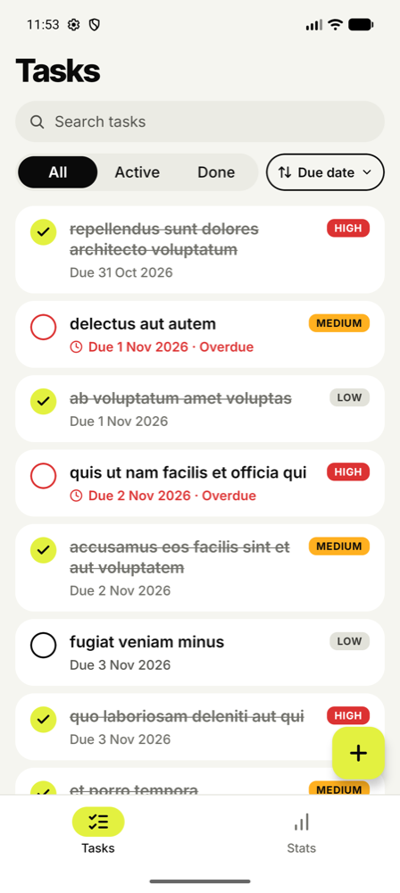
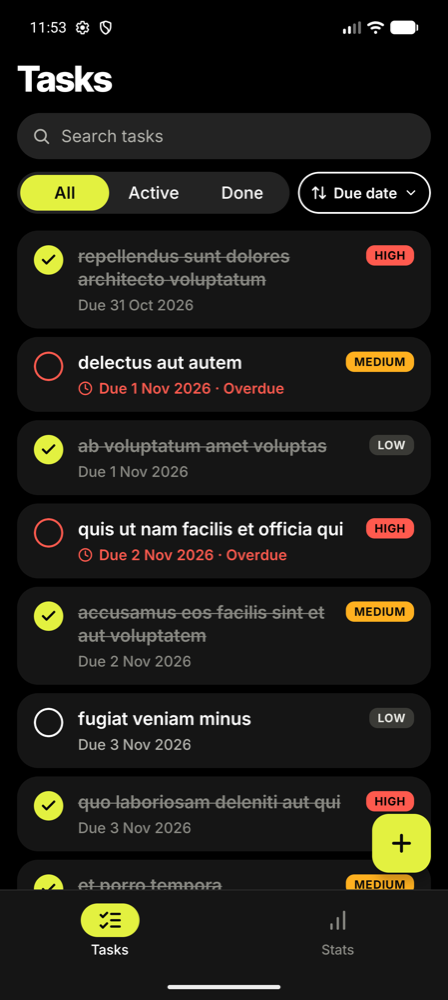
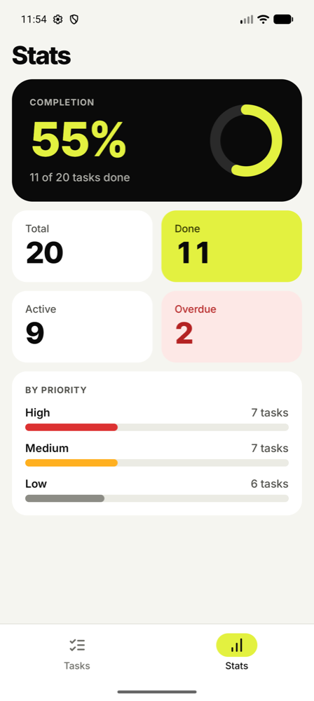

# KMPBrownfield-android

Jetpack Compose Tasks app on top of a **Kotlin Multiplatform** core. The domain, data and
presentation (ViewModel) layers come from
[KMPBrownfield-shared](https://github.com/Kaktotaks/KMPBrownfield-shared); this app keeps only
the Android UI, navigation and DI. It is the Android half of a brownfield KMP migration — the iOS
twin is [KMPBrownfield-ios](https://github.com/Kaktotaks/KMPBrownfield-ios), and both follow the same
[product spec](https://github.com/Kaktotaks/KMPBrownfield-shared/blob/main/docs/SPEC.md).

How the app got here: [`docs/MIGRATION.md`](docs/MIGRATION.md) (brownfield migration log).

The app seeds 20 todos from `https://jsonplaceholder.typicode.com/todos?_limit=20` on first launch; from then on the
tasks (and their voice notes) live in a local SQLite database (shared 0.7.0) and survive restarts, offline.

## Design

The UI follows the approved redesign — [`docs/design/DESIGN_HANDOFF.md`](docs/design/DESIGN_HANDOFF.md) (tokens, components,
screens, motion, copy, accessibility, acceptance criteria). It is a visual-layer change only: the shared module and its
ViewModels are untouched, and both apps look and behave the same except the chrome listed in handoff §0. The sort pill's
"Title" option comes from `SortOrder.TITLE` (shared 0.6.0).

| List | List (dark) | Stats |
|---|---|---|
|  |  |  |

More states (detail, editor with validation errors, error, empty) are in [`docs/design/screenshots`](docs/design/screenshots)
next to the iOS counterparts. Screenshots of the two apps differ in data only (the iOS ones use the fake-data preview
graph, the Android ones the live JSONPlaceholder data).

## Voice notes

A task can have one optional voice note (up to 2:00): record, play (seek, 1x / 1.5x / 2x), re-record and delete, in
Task detail (a card under Notes) and in the editor (a section under Due date); the list shows a mic + duration
indicator. Everything with logic (state machine, timer, limits, waveform, file lifecycle) is in shared's
`VoiceNoteViewModel`; the app only provides:

- `voice/MediaVoiceRecorder` (`MediaRecorder`: AAC in MPEG-4 .m4a, mono, 44.1 kHz, 64 kbps; level = `sqrt(maxAmplitude / 32767)`),
- `voice/MediaVoicePlayer` (`MediaPlayer` + playback speed, transient audio focus, pauses on focus loss / headphones unplugged),
- `voice/RuntimeMicPermission` + `ui/voice/MicPermissionHost` (Activity Result bridge),
- `ui/voice/*`: `VoiceNoteCard`, `VoiceRecorderView`, `VoicePlayerView`, `VoiceNoteIndicator`, `MicPermissionCard`
  (same names, layout and copy as iOS), previews for every state in light and dark.

**Permission:** `RECORD_AUDIO` (runtime). It is requested only after the in-app explainer card ("Continue"). After a
second denial the card offers "Open Settings" (`ACTION_APPLICATION_DETAILS_SETTINGS`); granting it there works on return.
The app records only while the card shows the recorder; leaving the app stops the recording and keeps it.

### Debug-only fake audio (screenshots, demos)

The `debug` source set (`app/src/debug`, absent from release builds) can replace the microphone, the player and the
permission dialog through launch extras (use `-S` so the process restarts):

```
adb shell am start -S -n com.example.tasks.android/.MainActivity \
  --ez fakeVoiceAudio true --es fakeMicPermission notDetermined --es seedVoice "1:42000,2:18000"
```

| Extra | Values | Effect |
|---|---|---|
| `fakeVoiceAudio` (bool) | `true` | fake recorder (moving levels, no mic) and fake player (wall clock) |
| `fakeMicPermission` (string) | `notDetermined` / `denied` / `granted` | fake permission; `request` grants it |
| `fakeMicDenyOnRequest` (bool) | `true` | with the above: Continue answers "denied" -> Microphone access is off |
| `forceVoiceError` (string) | `recordFailed` / `unavailable` | start throws -> "Couldn't record"; or the note cannot be played -> "Voice note unavailable" |
| `seedVoice` (string) | `taskId:durationMs,...` | attaches a fake voice note (40 synthetic bars) to those tasks after the first load |

## Architecture

```
TaskListScreen        stateless Compose UI: layout only, takes a UI model + event lambdas
      ^  TaskListUiModel
TaskListUiModel       pure Kotlin mapping (no Compose): formatting, labels, selected options,
      ^  TaskListUiState.toUiModel()       Loading / Error / Empty / Loaded
TaskListScreenRoute   stateful: viewModel(factory = …), collectAsStateWithLifecycle(),
      ^               maps state → UI model, wires viewModel::onX into the lambdas
TaskListViewModel     from shared (commonMain): presentation logic + UiState
      ^
TaskRepository, TaskValidator, TaskFilter, StatsCalculator, …   from shared (data + domain)
```

- **Screen** (`…Screen.kt`): only a UI model and lambdas — no ViewModel, no domain types, no string
  building; every screen has `@Preview`s built from sample UI models.
- **UI model** (`…UiModel.kt`): display-ready `data class`/`sealed interface` + a pure
  `UiState.toUiModel()` mapper, unit-tested on the JVM.
- **Route** (`…ScreenRoute.kt`): the only composable that touches the shared ViewModel; translates UI
  events into ViewModel calls (e.g. DatePicker millis → `LocalDate`, `if (viewModel.save()) onDismiss()`).
  The editor is a `ModalBottomSheet` hosted by the list/detail routes (`TaskEditorSheet`), not a navigation destination.
- **Shared ViewModels** (`com.example.tasks.shared.presentation`) are ordinary androidx ViewModels on
  Android: created by `ViewModelProvider`, scoped to the `NavBackStackEntry`, survive configuration
  changes. `ui/components/ViewModelFactories.kt` is the only Android-specific glue: it takes
  dependencies from `AppContainer` and reads `taskId` from the navigation route.
- **DI**: manual `AppContainer` in `TasksApplication` (one `KtorTaskApi`, `TaskRepository`,
  `TaskValidator`, `DateProvider`); tasks are loaded once in `onCreate`.

```
app/src/main/kotlin/com/example/tasks/android/
  ui/tasklist      TaskListScreenRoute, TaskListScreen, TaskListUiModel
  ui/taskdetail    TaskDetailScreenRoute, TaskDetailScreen, TaskDetailUiModel
  ui/taskeditor    TaskEditorSheet (ModalBottomSheet + shared VM), TaskEditorScreen, TaskEditorUiModel
  ui/stats         StatsScreenRoute, StatsScreen, StatsUiModel
  ui/components    TaskCard, CheckCircle, badges, buttons, fields, PillSegmentedControl, SortPill, cards, ring,
                   PriorityBar, EmptyState, Skeleton, TasksIcons (generated, shared with iOS), ViewModelFactories
  ui/navigation    Routes (type-safe @Serializable) + TasksRoot (Scaffold + NavigationBar + NavHost)
  ui/theme         TasksColors (+ CompositionLocal), TasksType (Inter), Radius/Spacing, Motion, TasksTheme -> MaterialTheme
                   (dynamic color off)
  MainActivity.kt, TasksApplication.kt (AppContainer)
```

### Stack
AGP 9.4.1 (built-in Kotlin), Kotlin 2.4.21, Gradle 9.6.0, compileSdk/targetSdk 37, minSdk 26 ·
Jetpack Compose (BOM 2026.09.00, Material 3) · Navigation Compose 2.10.2 · androidx Lifecycle 2.11.0 ·
kotlinx.coroutines 1.11.0 · kotlinx.serialization 1.12.0 (navigation routes only) ·
`com.example.tasks:shared:0.6.0` (brings Ktor + OkHttp, kotlinx-datetime and lifecycle-viewmodel
transitively).

## Build and run

Requirements: Android Studio (recent, with AGP 9.4 support) or a JDK 17+ for the command line (the
Gradle daemon provisions JDK 21 itself), an emulator or device with API 26+.

### Option A — from sources, no token (recommended for reviewers)
`-PuseLocalShared=true` makes `settings.gradle.kts` use `includeBuild("../shared")`, so the library
is built from source and GitHub Packages is not contacted. Clone both repos side by side; the shared
folder must be named `shared`:

```sh
mkdir KMPBrownfield && cd KMPBrownfield
git clone https://github.com/Kaktotaks/KMPBrownfield-shared shared
git clone https://github.com/Kaktotaks/KMPBrownfield-android android-app
cd android-app
./gradlew :app:assembleDebug -PuseLocalShared=true
./gradlew :app:installDebug -PuseLocalShared=true   # with an emulator/device connected
```

In Android Studio: add `useLocalShared=true` to `~/.gradle/gradle.properties` (or to this project's
`gradle.properties`, without committing it), then **Open** the `android-app` folder, sync, and run the
`app` configuration. Only the Android parts of `shared` are built.

### Option B — published artifact (default)
By default the app depends on `com.example.tasks:shared:0.6.0` (`gradle/libs.versions.toml`) from
GitHub Packages. GitHub Packages requires a token even for public packages — a classic PAT with
`read:packages` in `~/.gradle/gradle.properties`:

```properties
GitHubPackagesUsername=<github-login>
GitHubPackagesPassword=<classic PAT with read:packages>
```

Then `./gradlew :app:assembleDebug`, or open the project in Android Studio and run `app`.
Gradle reads the KMP Gradle module metadata and picks the Android variant (`shared-android`);
Kotlin/Native is not involved. Updating shared = bump `shared` in `libs.versions.toml` in its own PR.

## Tests
- App: JVM unit tests for the UI-model mappers, voice-note card mapping, level / permission / audio-focus logic and the
  VoiceNoteViewModel targets (`app/src/test`, `app/src/testDebug`, 36 tests) —
  `./gradlew :app:testDebugUnitTest` (add `-PuseLocalShared=true` for option A).
- Domain, repository and ViewModel tests live once in shared's `src/commonTest` and run on both
  platforms (`./gradlew allTests` in the shared repo).

## AI-assisted workflow
Developed with Claude Code as a pair programmer (commits carry `Co-Authored-By` trailers). The shared
library additionally has an automated Claude PR reviewer — see
[AI-assisted workflow](https://github.com/Kaktotaks/KMPBrownfield-shared#ai-assisted-workflow).

## License
[MIT](LICENSE) © 2026 Leonid Shevchenko
